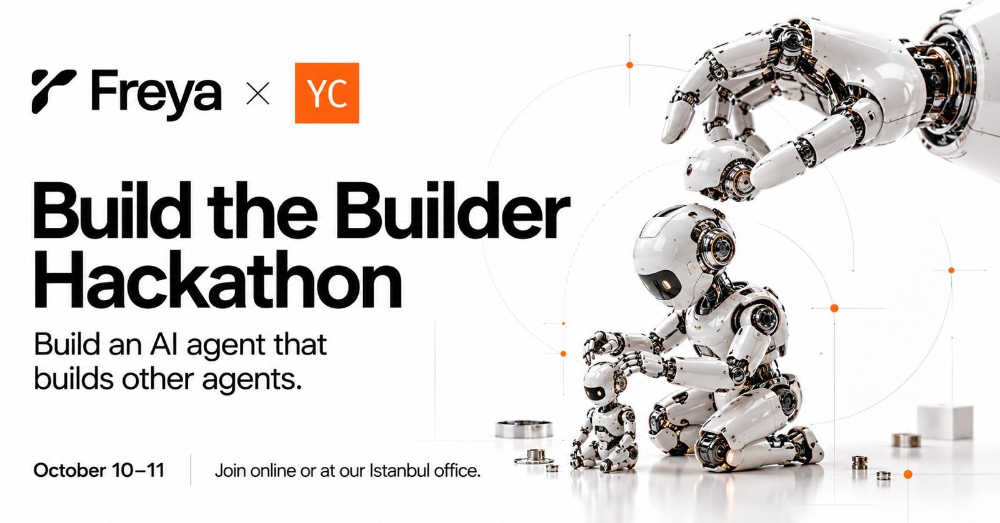
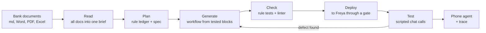
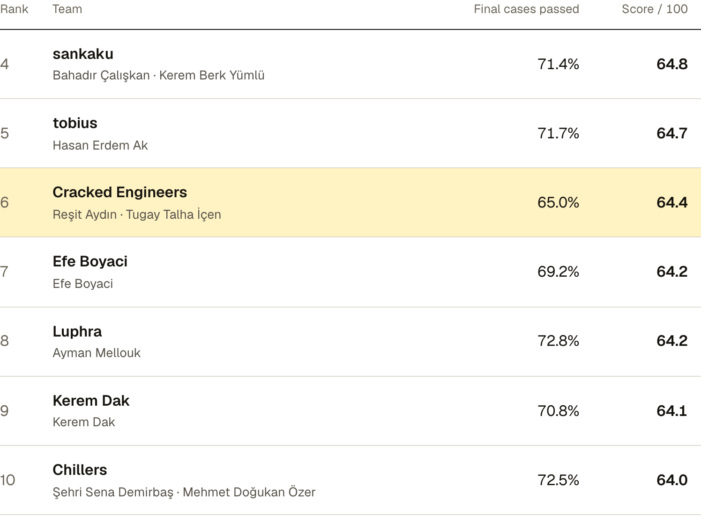

# The Builder

**An AI agent that builds other AI agents.** It reads a bank's documents and creates a working phone agent on [Freya](https://www.freyavoice.ai), with no edits by hand.

🏆 **[6th place](https://www.freyavoice.ai/hackathon/leaderboard)** at [Build the Builder — Freya × Y Combinator](https://www.freyavoice.ai/hackathon) (October 10–11, 2026). Team **Cracked Engineers**.



## The problem

A bank wants to phone customers who are late on a payment. The phone agent must check who is on the line, say what is owed, and record when the customer will pay. It must also follow the bank's rules: no debt talk before the identity check, no promise on a holiday, nothing said to a relative.

Today a person reads the bank's specification and builds this agent by hand. For one bank, that takes days.

The hackathon asked one question: **can a program do that work instead?**

> You build an agent. It builds an agent. We test that agent.

## What we built

One command. A folder of bank documents goes in. A deployed, tested phone agent comes out.

```
python3 builder/build.py {case_folder} {mock_url}
```

The final case was given only at the end of the event: a Turkish credit-card debt line, as raw bank material (a brief, mails, meeting transcripts, an FAQ, a service contract, a PDF call flow). In three hours we had to build a mock of the bank's services and run the builder on documents it had never seen.

## How it works



1. **Read.** `docs.py` turns the case folder into one brief. The tool API comes from the bank mock.
2. **Plan.** A Claude Agent SDK run splits the brief into atomic rules (the *ledger*). Each rule gets a mechanism: code, a route, a tool, a fixed line, or a prompt. Later documents that change a rule (a memo, a forwarded mail) replace the old rule.
3. **Generate.** The agent writes the workflow from tested building blocks: tool factories, node factories, identity checks, negotiation, date helpers.
4. **Check.** A unit test for each rule in code, plus a linter for platform pitfalls. Nothing deploys until every check passes.
5. **Deploy and test.** A deploy gate pushes the workflow to Freya. Then the agent runs scripted chat calls against it, fixes each failure, and deploys again. An independent reviewer subagent checks the result once.
6. **Hand off.** A watchdog stops the run on time. The builder exports the final workflow and a full trace with the keys removed.

More detail: [docs/architecture.md](docs/architecture.md).

## Results

[](https://www.freyavoice.ai/hackathon/leaderboard)

| | |
|---|---|
| **Final rank** | 6th ([leaderboard](https://www.freyavoice.ai/hackathon/leaderboard)) |
| **Total score** | 64.4 / 100 |
| **Simulation** | 78 of 120 hidden calls passed (65.0%), with all 13 happy-path calls passed |
| **Workflow quality** | 38 / 60, the second-highest in the top 6. The reviewers found that "almost all logic is in the right layer, in code" and that "every spoken sentence comes from templates in code". |
| **Final case** | Turkish card statement debt, raw bank documents, hidden customers |

A simulated call passes only when the bank's records are correct **and** the call followed the policy **and** the agent told the truth. There is no partial credit. Workflow quality is a review of the generated agent in 6 areas: duplication, conflicts, right layer, phone, tool design, and prompt writing.

## Team

| | Main work |
|---|---|
| **Reşit Aydın** ([@resitaydin](https://github.com/resitaydin)) | The builder: Agent SDK harness, skill and platform knowledge, building blocks, checks, deploy gate and tests. The evaluation loop. The Cloudflare bank mock. The final-case runs and the submission. |
| **Tugay Talha İçen** ([@Tugaytalha](https://github.com/Tugaytalha)) | The persona simulator: 50 simulated callers and judge reports on each final build. The reference agent. Windows support. The architecture document, the run guide and the jury presentation. |

The original repository is [Tugaytalha/The-Builder](https://github.com/Tugaytalha/The-Builder).

## Tech

Python 3.12 · [Claude Agent SDK](https://docs.claude.com/en/docs/agent-sdk/overview) · Freya workflow API · Cloudflare Workers + Durable Objects (JavaScript) · pytest

## Run it

The full guide for macOS, Linux and Windows is in **[HOW_TO_RUN.md](HOW_TO_RUN.md)**: install, keys, checks, a run, and what to do when it fails.

```
python3 builder/build.py {case_folder} {mock_url}       # a folder of bank documents and its mock
python3 builder/build.py {brief_path} {tool_api_path}   # a practice brief and its tool API file
python3 -m pytest builder/tests                          # tests
```

## Repository layout

| Path | What it is |
|---|---|
| `builder/build.py` | Entry point: trace, watchdog, one Agent SDK run, final deploy, export. |
| `builder/blocks/` | Tested building blocks: documents to text, tools, nodes, patterns, dates, linter, checks, deploy gate, smoke tests. |
| `builder/.claude/` | The skill the agent follows, the Freya platform notes, a worked example, and the reviewer subagent. |
| `mock/` | The bank mock: a Cloudflare Worker with one Durable Object. |
| `eval/` | Our evaluation loop: variant briefs, cases, the runner, a contamination check, the persona simulator. |
| `submission/`, `traces/` | The submitted workflows and the builder traces. |
| `notes/` | Platform findings, the evaluation log, and the test reports. |
| `presentation/` | The jury presentation (English and Turkish). |

## Links

- [Build the Builder hackathon page](https://www.freyavoice.ai/hackathon)
- [Final leaderboard](https://www.freyavoice.ai/hackathon/leaderboard)
- [Event page on Y Combinator](https://events.ycombinator.com/AI-FDE-Build-the-Builder)
- [Freya](https://www.freyavoice.ai)
- [Claude Agent SDK](https://docs.claude.com/en/docs/agent-sdk/overview)

## License

[MIT](LICENSE) © 2026 Reşit Aydın and Tugay Talha İçen
